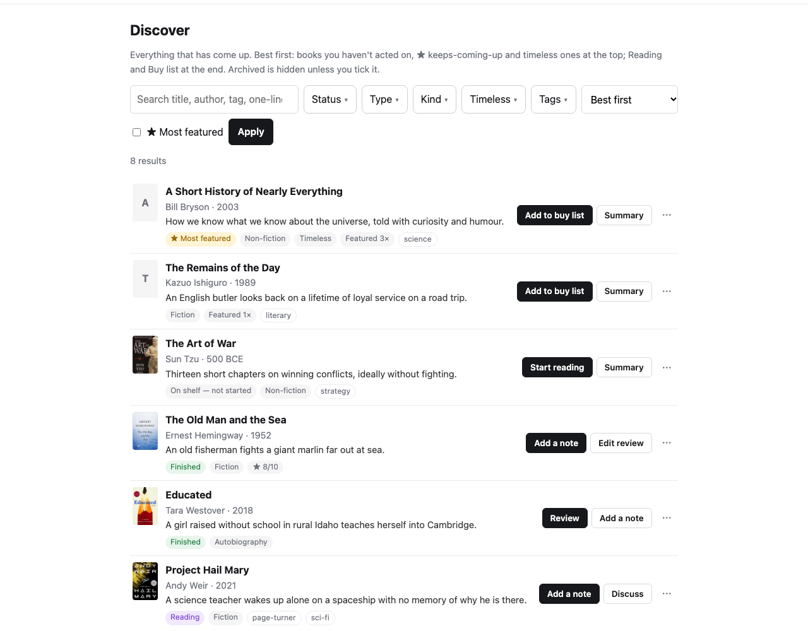
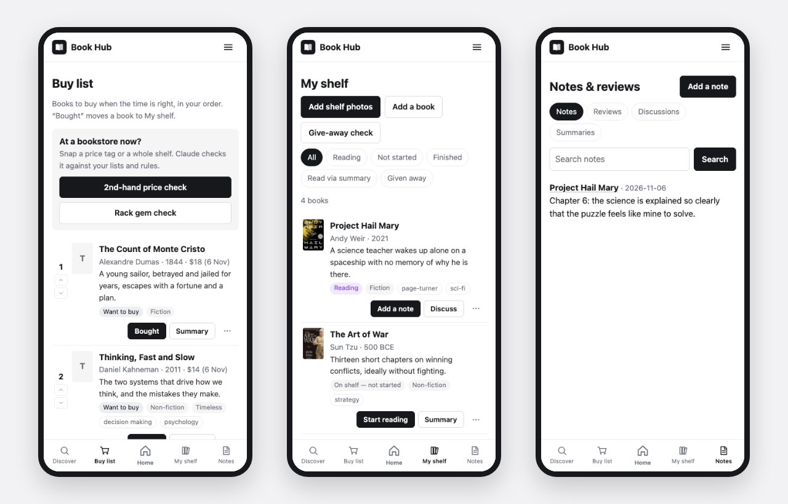
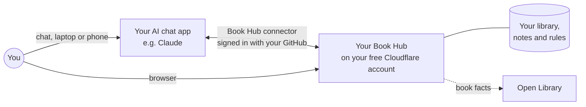

# Book Hub

**Your private AI reading advisor.** Less noise, better choices. Ask your AI chat app whether a book is worth your time, whether to buy it, or which books on a bookstore rack are gems. Book Hub filters everything through your own rules and library, remembers it all, and works through the AI subscription you already have. No API key, nothing to pay for hosting.

Screenshots use a sample library.

---

## Why Book Hub

For a book lover, the hard part isn't finding books. It's deciding.

- **Recommendations come from everywhere:** friends, podcasts, links, people you follow, a sudden need. Not all are worth it, and each has to pass *your* filter. Today that means checking the same things again and again.
- **Big portals add noise.** More ratings, lists and opinions make deciding harder. What a reader needs is less clutter and a calm, personal decision.
- **Time is the real cost.** Some books deserve a week; others are better as a 30-minute summary.
- **Every reader is different.** Books change us, comfort us, explain the world or simply make us feel understood. What fits depends on your goal, your language, your experience and your stage of life.
- **Some books need a companion.** Dense classics and ancient texts read better with someone to explain and discuss them.
- **Buying is part of the joy.** First-hand or second-hand, now or later. An unread shelf is fine, but every purchase is a choice. And second-hand bookstores are a book lover's playground.
- **Serendipity matters.** The right book at the right moment is bliss.
- **Books move with you.** When you move house or the shelf overflows, passing books on closes the loop.

Book Hub is a calm, personal reading assistant for these moments. It filters everything through **your** rules, taste and library, and remembers it all for next time.

## Who it's for

- Readers of **fiction and general non-fiction** who want help deciding what to read and buy.
- People who already pay for an **AI chat subscription**. Claude Pro is tested; see [Works with](#works-with).
- Anyone comfortable following a step-by-step guide once (about 30–45 minutes). After that it all happens in chat and in the browser, on laptop or phone.

**Not a fit (yet):** textbook-heavy reading, social features and book clubs, or wanting an app from an app store.

## How it helps

| The moment | What Book Hub does |
|---|---|
| **"Someone recommended this. Is it for me?"** | Paste a name, a list, a link or a photo. Each book gets three clear answers: **Quality** (is it a good book?), **Timeless** (has it lasted?) and **Fit** (is it right for you?), plus a **Verdict**: Read, Read parts, Idea only, Bench or Skip, and how to get it. Also: what it's about (no spoilers), weaknesses, and ratings and endorsements with links. Already in your library? It says so. |
| **"I need a book on…"** | Ask for recommendations on a topic, a question or "books like X". A short ranked list, never padded. Fewer, or none, if nothing good fits. |
| **"It keeps coming up."** | ★ **Most featured** marks books recommended across separate requests, so the ones that really matter rise above the noise. |
| **"Do I even need to read it?"** | **Book Quiz** (`/book-quiz`): about 5–10 minutes of questions on the book's core ideas, built so common sense can't answer them. You get **"You already know: X/10"** and a Verdict: skip it, read just the parts you're missing, read it, or practise instead of reading. |
| **"Is it worth a week of my time?"** | A **long summary** (30–60 minutes) with pictures, an honest critique and a straight answer to "can this replace the book?", in a reading view with contents, versions and PDF download. |
| **"Help me understand this."** | **Discuss** a chapter or idea while you read; your AI uses your notes and past discussions. Saved to your hub. |
| **"Should I buy it, and how?"** | The Verdict says whether to read it at all, and how to get it: first-hand, second-hand, Kindle or a summary, following your buying preferences. The **Buy list** keeps your order and the last-known price. |
| **"I'm in a second-hand bookstore."** | Snap a price tag: buy or skip, and the discount versus new. Snap a whole rack: up to five gems worth picking. |
| **"What do I own, and what am I reading?"** | Photograph your shelf to catalogue it. Statuses move as you act: Not started → Reading → Finished. **Pin** up to 5 books to keep your current focus on top. Notes (dictation works) and reviews with a rating and "would you re-read?". |
| **"Surprise me."** | A monthly **check-in**: books like the ones you loved, something different or even opposing, and what's waiting on your Buy list. |
| **"I'm moving house."** | A **give-away check** suggests which books can go, and never your keepers. |

**Built in everywhere:**
- **Your rules.** **About me as a reader** says what you enjoy, what you're working on and how you like to get books. **How I judge books** sets what counts as a good book (gates and weighted factors), what Fit means and how the Verdict is decided. Both work well untouched, and everything is plain text you can edit in the hub.
- **Never made up.** Ratings, prices and endorsements always carry a link and a date, or say "couldn't fetch".
- **Two ways in, always in sync.** Use the hub's website or just chat; both read and write the same library.
- **Your data.** Everything lives in your own Cloudflare account. Download it any time as Markdown (handy for Obsidian and other notes apps) or as a full JSON backup.

## How it works

- **Book Hub is a small website plus a "connector"** (using MCP, the open standard AI apps use to connect to tools), running in your own Cloudflare account.
- **Your AI app does the thinking.** Before answering, it reads your rules and library through the connector, and saves what it finds back to your hub.
- **The hub itself never calls an AI.** That's why there's no API key and no per-use bill. Buttons in the hub open your AI app with the request typed in.
- **Only you can sign in**, with your GitHub account, both on the website and in the connector.

More detail: [How it works](docs/HOW-IT-WORKS.md).

## What it costs

| | Cost |
|---|---|
| Your AI subscription | What you already pay (e.g. Claude Pro). Book Hub uses your normal chat usage. |
| Hosting (Cloudflare Workers + D1, free plan) | **Free.** A personal library uses a few percent of the daily free limits. If a limit is ever reached, the hub pauses until the next day; the free plan never bills you. |
| GitHub account | Free |

## Works with

| AI app | Status | Notes |
|---|---|---|
| **Claude** (Pro, Max, Team), web, desktop and mobile apps | ✅ **Tested** | Full support: connector plus skills (`/book-recs`, `/book-details` and so on). |
| ChatGPT (Plus and above, web) | Not tested | Custom connectors work in Developer mode; saving asks for confirmation each time. No skills on Plus: set **Settings → AI app → ChatGPT** in the hub and its buttons send the request in plain words. |
| Gemini (Google AI Pro, "custom apps") | Not tested | Rolling out by region. No skills; use the hub's buttons with **AI app → Another AI app** (copies the request). |
| Coding agents (Claude Code, Gemini CLI, Cursor and others) | Should work | They support connectors and the same skill format. |

The rules live in your hub, not in the AI app, so any app that can use the connector gets the same behaviour. If you try another app, please [share how it went](../../issues).

## Get started

**→ [Setup guide](docs/SETUP.md)**: about 30–45 minutes, once. You need:

1. A **GitHub** account (free): for your copy of the code and for signing in.
2. A **Cloudflare** account (free, no card needed): where your hub runs.
3. A computer (Mac, Windows or Linux) for the one-time setup. After that, a phone is enough.
4. An AI subscription that supports connectors. Claude Pro or above is tested.

**Easiest:** if you have Claude Code (included with Claude Pro), it can run the setup with you. You'll only need to click "Allow" a few times in the browser. The guide also has every step written out by hand.

## Your first five minutes

1. **About me** (optional, 2–5 minutes): in the hub, Home → Set up Book Hub, or Profile & settings → About me as a reader. Why you read, your subjects, what you're working on.
2. **Snap your shelf:** Book Hub → My shelf → *Add shelf photos*, or type `/book-shelf` in Claude and send a photo.
3. **Ask about a book you're considering:** `/book-details The Count of Monte Cristo`.
4. **Ask for recommendations:** `/book-recs books that explain how science works`.

## Privacy and security

- **Your data is yours.** It's stored only in your own Cloudflare account. There's no central Book Hub server, and nothing is sent to the people who made Book Hub.
- **Only you can sign in.** The hub and the connector both check your GitHub username. Everyone else is turned away.
- **The AI can't delete anything.** The connector has no delete tools; deleting and merging happen only in the hub.
- **What leaves your hub:** book titles go to [Open Library](https://openlibrary.org) to look up details. Your AI app sees what you share in chat, under its own privacy terms.
- **Secrets** (sign-in keys) are stored as encrypted Cloudflare secrets, never in code.

Found a security problem? See [SECURITY.md](SECURITY.md).

## Limits

- **One person per hub.** Each reader runs their own copy.
- **Tested with Claude.** Other AI apps should work but haven't been tested.
- **Ratings and prices come from your AI's web search,** so they can be missing. They're always linked and dated.
- **English only** for now.

## Roadmap

Planned, roughly in this order:

- [ ] **One-click "Deploy to Cloudflare"** button to shorten setup
- [ ] **Sync to a local folder** (e.g. an Obsidian vault) without scripts
- [ ] **Kindle integration:** your Kindle library and highlights (from Kindle's own export; no DRM removal)
- [ ] **AI interview** to fill in your reader profile
- [ ] **Goodreads import** (from Goodreads' CSV export)
- [ ] **Reading stats:** what you read, when, and how you rated it
- [ ] **Step-by-step guides for ChatGPT and Gemini,** once tested
- [ ] **Example for API users:** connecting an API-based agent to your hub
- [ ] Easier Buy list reordering

Ideas welcome: [open an issue](../../issues).

## FAQ

**Do I need an API key?** No. Book Hub works through your normal chat subscription. The hub never calls an AI itself.

**Can I use it without Claude?** Probably, with any AI app that supports custom connectors (MCP), but only Claude has been tested. See [Works with](#works-with).

**I want to use the API instead of a chat subscription.** Book Hub doesn't need changing: any API-based agent that supports MCP can connect to your hub's `/mcp` address. You'd adapt the instructions in `skills/` for your agent.

**What happens if I hit the free Cloudflare limits?** The hub pauses until the next day. You're never billed on the free plan. A personal library typically uses a few percent of the limits.

**Can I change how it judges books?** Yes. Profile & settings → How I judge books: turn Quality gates on or off, change factor weights, edit the Fit scale and the Verdict steps. Every rule is editable and every earlier version is kept.

**How do I update to a new version?** See [Updating](docs/SETUP.md#updating).

**Is my reading data shared with anyone?** No. See [Privacy and security](#privacy-and-security).

## Contributing

Book Hub is maintained in spare time. Issues are reviewed about once a month, bugs sooner. Bug reports and ideas are very welcome; for code changes, please open an issue first so we can agree on the approach. See [CONTRIBUTING.md](CONTRIBUTING.md).

## Licence and credits

[MIT](LICENSE). Book details from [Open Library](https://openlibrary.org). Runs on [Cloudflare Workers](https://workers.cloudflare.com).

Built with [Claude Code](https://claude.com/claude-code).
