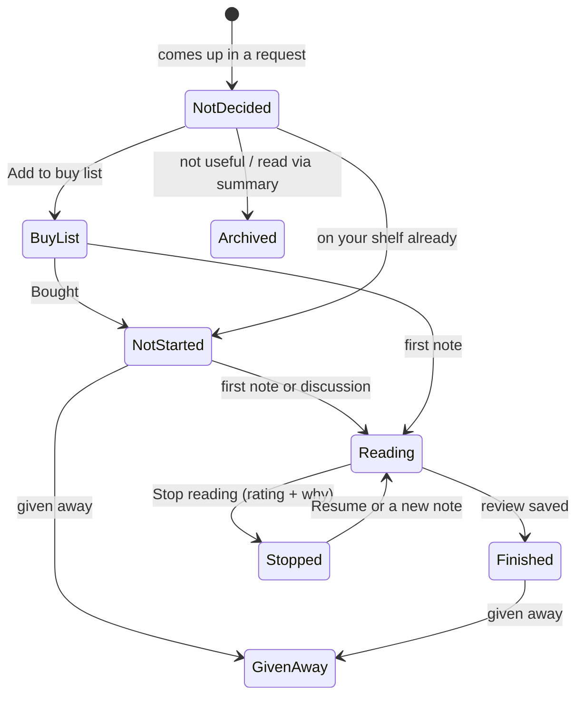

# How Book Hub works

For readers who want to know what's under the hood, and for anyone changing the code. Coding agents: also see [AGENTS.md](../AGENTS.md).

## The idea

Book Hub splits the work in two:

- **Your AI chat app does the thinking:** research, judging, writing cards and summaries. You already pay for it, so there's no API bill.
- **Your hub remembers:** books, statuses, notes, reviews, research and your rules. It runs on Cloudflare's free plan, in your own account.

The two talk through a **connector** using MCP (Model Context Protocol), the open standard AI apps use to connect to outside tools. The hub never calls an AI itself.

## Parts

| Part | What it is | Where |
|---|---|---|
| Connector | Tools the AI can call: look up a book, save it, read rules, add a note, save a review, and so on. **No delete tools.** | `src/mcp.ts` at `/mcp` |
| Hub | The website: Home, Discover, Buy list, My shelf, Notes, Profile & settings | `src/hub/` at `/` |
| Sign-in | GitHub sign-in, owner only, for both the hub (a session cookie) and the connector (OAuth for AI apps) | `src/auth.ts`, `src/index.ts` |
| Database | Cloudflare D1 (SQLite): books, notes, research, requests, rules, settings | `src/db.ts`, `migrations/` |
| Rules | Plain-Markdown criteria the AI reads before answering, in three groups: About me as a reader, How I judge books, System rules. Defaults ship in `rules/`; each hub keeps its own editable copy | `rules/`, `src/rules-defaults.ts`, Profile & settings |
| Skills | Short instructions for Claude. Each asks the hub for the rules of its command (a "flow"), so adding or changing rules never needs a skill re-upload | `skills/` |
| Book facts | Titles, years, pages and covers from Open Library (free, no key) | `src/openlibrary.ts` |

## A book's life

Eight statuses, moved by what you do rather than by bookkeeping:

Automatic changes only move forward (a note never "un-finishes" a book). You can set any status by hand on the book's page.

## How a recommendation is made

1. You ask, e.g. `/book-recs books on decision making`.
2. The AI reads the rules for that command (quality, fit, verdict, ranking, output format, honesty, your profiles).
3. It picks candidates fresh from the question, drops books that fail a Quality gate, and ranks by how directly each answers the question, then by Quality. Your library only labels books and flags overlap; it never changes the order.
4. It researches with web search, then saves each book, its card (with Quality, Timeless, Fit and Verdict) and the facts it found (each with a link and date).
5. It logs the request. Books recommended across **separate** requests count towards ★ **Most featured**.
6. It answers with a ranked table, cards, a "For this question" line per book, and links back to your hub.

Research is reused: ask about the same book next month and the saved card is used, with only stale facts refreshed.

## Quality, Timeless, Fit and Verdict

Every book gets three answers and one decision. Each criterion lives in exactly one place.

| | Question | About | Saved |
|---|---|---|---|
| **Quality** /10 | Is it a good book? Gates (stretched, repackaged, false…) and weighted factors | the book only: what you've read or like never changes it | with the card |
| **Timeless** | Has it lasted? Yes / No / Too new | the book | with the card |
| **Fit** /10 | Is it right for you? **Self** (serves something you're working on) and **General** (helps you understand the world) | you: your profiles | with the card |
| **Verdict** | What to do: Read, Read parts, Reread, Idea only, Bench, Skip, and how to get it | the decision | on the book, with its history |

- **Match** (how directly a book answers your question) only orders a list. It changes every question and isn't saved.
- The Verdict is the same on every question. It changes only when its inputs change (you finish an overlapping book, edit your profile, or new facts appear), always with a reason. **Your own verdict is locked**: the AI can only say if it disagrees. A Verdict never moves a book between your lists.
- Discover hides Skip unless you ask for it.
- All of this is editable in Profile & settings: **About me as a reader** (profiles, people you trust, buying preferences) and **How I judge books** (gates, factor weights, the Fit scale, the Verdict steps).

## Book Quiz

`/book-quiz <book>` finds out how much of a book you already hold, so you can decide whether reading it is still worth your time.

- **Scan first:** 5 questions (about 5 minutes) on the book's core ideas and what it adds beyond the popular summary. If the result is in between, it offers **Deep**: a few more questions on the uncertain ideas (15 at most).
- Questions are mostly open (explain it, apply it to a situation where the intuitive answer is wrong), plus one multiple-choice question built from the common misreadings. Questions a thoughtful person could answer without the book are dropped. Answers come at the end.
- Each idea is graded Held, Known but not lived, Partly or New. **You already know: X/10**: 8+ → Skip · 5.5–7.9 → Read parts · below 5.5 → Read. A self-help book you understand but don't act on → **Practise instead**.
- The result sets and locks the book's Verdict (your own verdict, set later, wins). A quiz Skip leaves Discover. Biographies, wisdom texts and art books are only informed, never locked. Stopped midway? Home offers to continue.

## Security model

- Only the GitHub account named in the `OWNER_GITHUB_LOGIN` secret can sign in to the hub or authorise an AI app. Anyone else gets "This Book Hub belongs to someone else". If that secret is missing, nobody can sign in.
- Forms only work from the hub's own pages (cookies are `SameSite=Lax`, plus an Origin check).
- The connector can add and update, never delete. Deleting and merging are hub-only.
- AI apps can read rules but not change them. Rules and profiles are edited in the hub, and every version is kept.
- Secrets live as encrypted Cloudflare secrets. `.dev.vars` (local testing only) is git-ignored.

## Free-plan usage

A personal library uses a small share of Cloudflare's free daily limits (100,000 requests, 5 million database row reads). If a limit is reached, the hub pauses until the next day; the free plan never bills you.

## Tests

- `npm test`: automatic tests inside the Workers runtime (database, statuses, connector tools, every hub page).
- `scripts/preview.sh`: loads a sample library and screenshots every page at laptop and phone width.
- `evals/run.sh`: behaviour tests: real requests through Claude Code against a local copy, checked automatically.
- Every push runs the type check and tests on GitHub.
