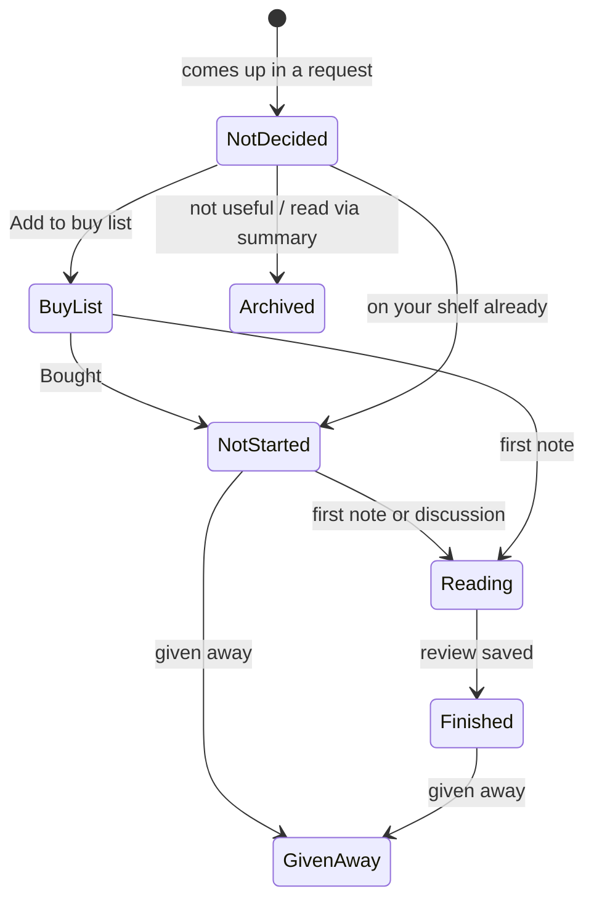

# How Book Hub works

For readers who want to know what's under the hood, and for anyone changing the code. Coding agents: also see [AGENTS.md](../AGENTS.md).

## The idea

Book Hub splits the work in two:

- **Your AI chat app does the thinking:** research, judging, writing cards and summaries. You already pay for it, so there's no API bill.
- **Your hub remembers:** books, statuses, notes, reviews, research and your rules. It runs on Cloudflare's free plan, in your own account.

The two talk through a **connector** using MCP (Model Context Protocol), the open standard AI apps use to connect to outside tools. The hub never calls an AI itself.

## Parts

| Part | What it is | Where |
|---|---|---|
| Connector | Tools the AI can call: look up a book, save it, read rules, add a note, save a review, and so on. **No delete tools.** | `src/mcp.ts` at `/mcp` |
| Hub | The website: Home, Discover, Buy list, My shelf, Notes, Profile & settings | `src/hub/` at `/` |
| Sign-in | GitHub sign-in, owner only, for both the hub (a session cookie) and the connector (OAuth for AI apps) | `src/auth.ts`, `src/index.ts` |
| Database | Cloudflare D1 (SQLite): books, notes, research, requests, rules, settings | `src/db.ts`, `migrations/` |
| Rules | Plain-Markdown criteria the AI reads before answering. Defaults ship in `rules/`; each hub keeps its own editable copy | `rules/`, Profile & settings → Rules |
| Skills | Short instructions for Claude that say which rules to read for each command | `skills/` |
| Book facts | Titles, years, pages and covers from Open Library (free, no key) | `src/openlibrary.ts` |

## A book's life

Seven statuses, moved by what you do rather than by bookkeeping:

Automatic changes only move forward (a note never "un-finishes" a book). You can set any status by hand on the book's page.

## How a recommendation is made

1. You ask, e.g. `/book-recs books on decision making`.
2. The AI reads your rules (ranking, timeless test, output format, honesty, your taste) and checks your library.
3. It researches with web search, then saves each book, its card and the facts it found (each with a link and date).
4. It logs the request. Books recommended across **separate** requests count towards ★ **Most featured**.
5. It answers with a ranked table, cards, and links back to your hub.

Research is reused: ask about the same book next month and the saved card is used, with only stale facts refreshed.

## Fit and taste

- **Fit (x/10)** is how well a book matches the question you asked, your taste (Profile & settings → Your taste) and your library.
- **Timeless** is a separate test for non-fiction: has it survived decades of serious readers recommending it? Fiction gets a **Classic status** from evidence.
- Taste only sharpens fit and ranking. It never changes the facts, the timeless verdict or the evidence rules.

## Security model

- Only the GitHub account named in the `OWNER_GITHUB_LOGIN` secret can sign in to the hub or authorise an AI app. Anyone else gets "This Book Hub belongs to someone else". If that secret is missing, nobody can sign in.
- Forms only work from the hub's own pages (cookies are `SameSite=Lax`, plus an Origin check).
- The connector can add and update, never delete. Deleting and merging are hub-only.
- AI apps can read rules but not change them. Rules and taste are edited in the hub, and every version is kept.
- Secrets live as encrypted Cloudflare secrets. `.dev.vars` (local testing only) is git-ignored.

## Free-plan usage

A personal library uses a small share of Cloudflare's free daily limits (100,000 requests, 5 million database row reads). If a limit is reached, the hub pauses until the next day; the free plan never bills you.

## Tests

- `npm test`: automatic tests inside the Workers runtime (database, statuses, connector tools, every hub page).
- `scripts/preview.sh`: loads a sample library and screenshots every page at laptop and phone width.
- `evals/run.sh`: behaviour tests: real requests through Claude Code against a local copy, checked automatically.
- Every push runs the type check and tests on GitHub.
